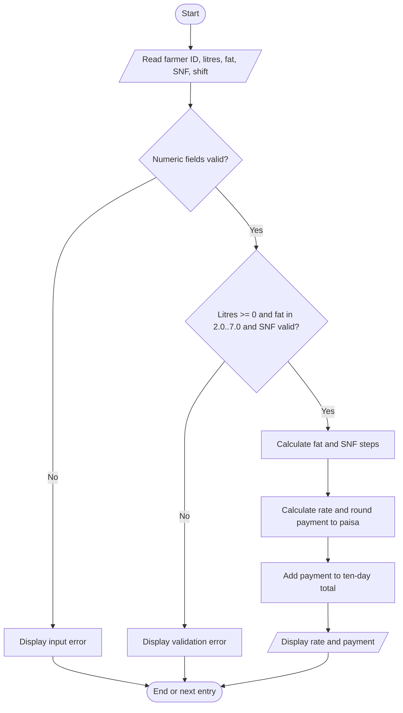

# Task 8 — Algorithm

## Pseudocode (language-neutral structured style)

```
BEGIN
    SET ten_day_total = 0.00
    FOR each delivery entry
        READ farmer_id, litres, fat, snf, shift
        IF any numeric field is invalid THEN
            DISPLAY error
            CONTINUE to next entry
        ENDIF
        IF litres < 0 OR fat < 2.0 OR fat > 7.0 THEN
            DISPLAY validation error
            CONTINUE to next entry
        ENDIF
        fat_steps = nearest_integer((fat - 3.5) / 0.1)
        snf_steps = nearest_integer((snf - 8.5) / 0.1)
        rate = 30.00 + fat_steps * 0.40 + snf_steps * 0.30
        amount = round_to_paisa(litres * rate)
        ten_day_total = ten_day_total + amount
        DISPLAY farmer_id, rate, amount
    ENDFOR
    DISPLAY ten_day_total
END
```

## Flowchart



## Hand trace

| Farmer | Litres | Fat | SNF | Rate | Payment |
|---|---:|---:|---:|---:|---:|
| F001 | 10 | 3.5 | 8.5 | ₹30.00 | ₹300.00 |
| F002 | 8.5 | 4.2 | 8.7 | ₹33.40 | ₹283.90 |
| F003 | 12 | 3.1 | 8.3 | ₹27.80 | ₹333.60 |
| **Total** | | | | | **₹917.50** |

Both list storage and a running total take O(n) time. Storing entries takes O(n) space and supports audits/reports/recalculation; a running total uses O(1) additional space and is suitable when only the final total is needed.
