# Python Programming — Assignment 1 Report

## Cover page

**Title:** Design, Implement and Validate a Payment Calculator for a Village Milk Co-operative  
**Student name:** J. Hutson Kanth  
**Register number:** 1921260129  
**Course:** Python Programming   
**Python version used for the included test run:** Python 3.13.5  

## Objective

Design and test a payment calculator that converts milk fat and SNF readings into a per-litre rate, validates delivery records, calculates payments to the nearest paisa, and demonstrates a seasonal rate change.

## Task 1 — Problem analysis

The inputs are farmer ID, litres delivered, fat percentage, SNF percentage and shift. The outputs are rate per litre, amount for each delivery and the accumulated total. The farmer ID and shift are strings; measurement values are decimals; calculated step counts are integers; validation decisions are Booleans. A record list is suitable because the same loop can process 300, 6,000 or 150,000 entries without adding a new set of variables for every farmer.

The base rate is ₹30.00 at reference fat 3.5% and SNF 8.5%. Each 0.1 percentage-point fat step changes the rate by ₹0.40, and each 0.1 percentage-point SNF step changes the rate by ₹0.30. The program rejects negative quantity, fat outside 2.0–7.0%, invalid numeric readings, blank IDs and invalid shifts. The SNF range of 6.0–10.0% is an assumption to verify with the co-operative. A list with `n` records takes O(n) storage and a pass through the records takes O(n) time.

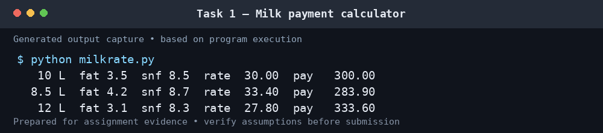

## Task 2 — Values, types and arithmetic

The examples distinguish `int`, `float`, `str`, `bool` and `list`, and compare true division `/`, floor division `//` and remainder `%`. Floor division rounds downward, so `-7 // 2` is `-4`. Binary floats do not represent many decimal fractions exactly: `0.1 + 0.2 == 0.3` is false. Decimal values constructed from strings and integer paise provide more reliable representations for money. The included Decimal demo sums 1,000 payments of ₹33.40 and three payments of ₹0.10.

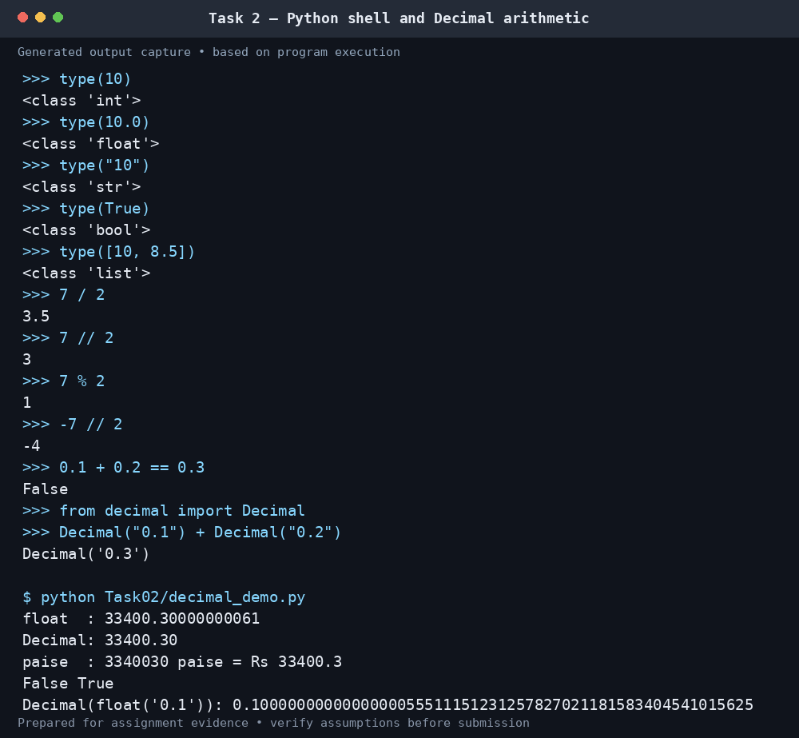

## Task 3 — Variables and constants

The rate card is stored in uppercase constants in `milkrate.py`. This is a naming convention; Python does not enforce immutability. Dynamic typing allows variables to refer to different types, while multiple assignment permits a swap such as `a, b = b, a`. Centralising the settings means a rate change can be made once rather than at every calculation site. The rate calculation remains O(1) in time and auxiliary space.

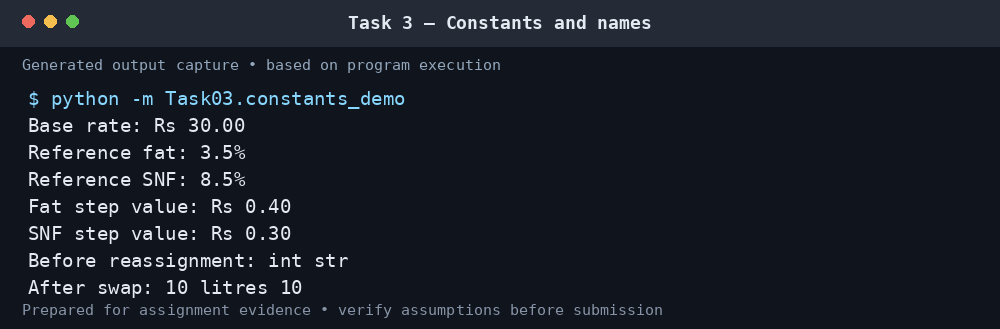

## Task 4 — Expressions and rounding

Fat and SNF step counts are computed relative to reference readings in increments of 0.1 percentage points. The rate is the base rate plus the fat adjustment plus the SNF adjustment; the delivery payment is litres multiplied by the rate. The task compares `round`, `int` and `floor` for positive and negative step counts. `int` truncates toward zero, which can give a different result from rounding a negative adjustment. Binary floating-point effects also explain why some mathematically neat divisions show a tiny residual.

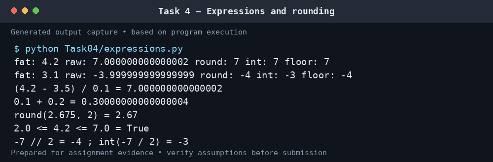

## Task 5 — Input and conversion

`input()` returns text, so numeric input must be converted. The demonstration retries after invalid values and asks for a decimal point rather than a comma. `try/except ValueError` handles malformed input without terminating the program. IDs are retained as strings so leading zeroes are not lost. Formatting with fixed width and two decimal places makes the output easier to check.

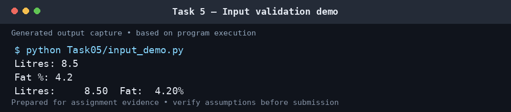

## Task 6 — Functions and scope

`rate_per_litre`, `payout` and `ten_day_total` separate the calculation into reusable operations. `show_payment` prints a record and returns the payment, so the caller can add amounts to the total. A return value can be tested and reused while printing alone only displays information. Processing `n` records is O(n); each individual rate calculation is O(1).

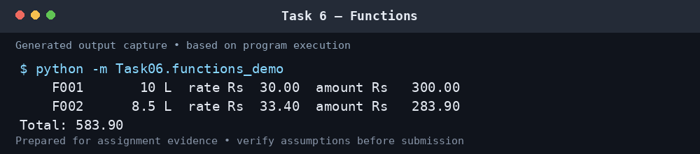

## Task 7 — Modules

The main calculations live in `milkrate.py`, which is imported by demonstrations and tests. The `if __name__ == "__main__":` guard prevents the demonstration table from printing when the module is imported. The import check shows that the shared `payout` function is available and returns the expected amount of ₹283.90 for the second example delivery.

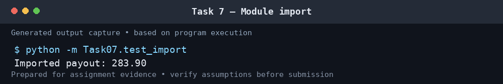

## Task 8 — Algorithm and flowchart

The program reads a record, confirms the readings are valid, calculates rate and payment, adds the rounded payment to the running total and displays the result. An invalid entry produces an error and does not enter the total. A list supports later auditing or recalculation but uses O(n) storage. If only a grand total is required, a running accumulator uses O(1) additional space. The hand trace gives payments of ₹300.00, ₹283.90 and ₹333.60, totalling ₹917.50.

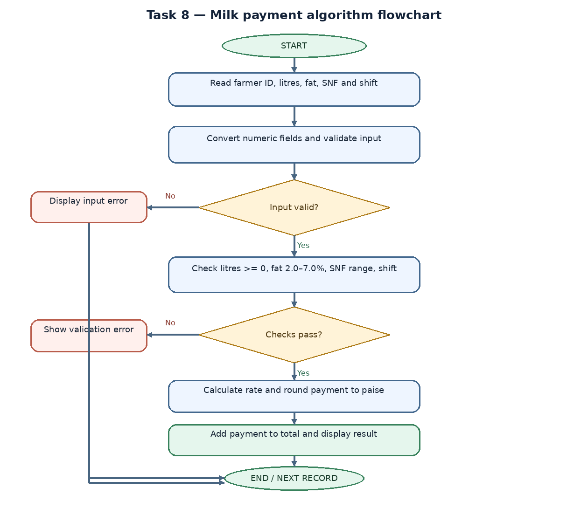

## Task 9 — Implementation and validation

The interactive calculator validates each entry before calculation. Automated tests cover the normal reference rate, higher and lower fat/SNF values, accepted fat boundaries, rejected fat out of range, negative litres, invalid numeric text and a blank farmer ID. All twelve included unit tests pass in the environment used to prepare this pack. For `m` test cases, the test run is O(m).

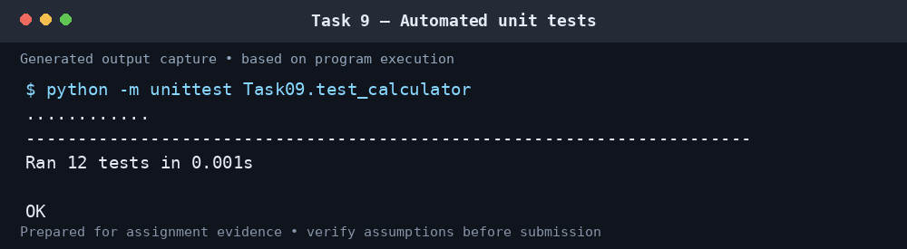

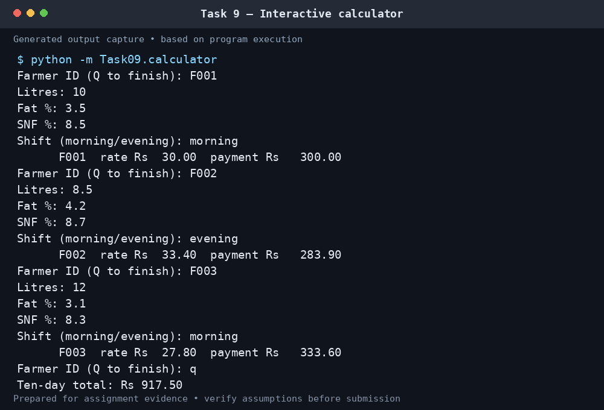

## Task 10 — Performance and monetary accuracy

The benchmark compares a floating-point sum with a Decimal sum for 300, 6,000 and 150,000 payments of ₹33.40. The following measurements were observed when the included script ran under Python 3.13.5 in the environment that produced these files. These are **not measurements from the student's PC**; timing varies with hardware, operating system and Python build.

| Payments (n) | Float total (shortened) | Decimal total | Float time (s) | Decimal time (s) |
|---:|---:|---:|---:|---:|
| 300 | 10019.9999999999 | 10020.00 | 0.000019 | 0.000059 |
| 6,000 | 200399.999999979 | 200400.00 | 0.000326 | 0.000926 |
| 150,000 | 5010000.00000084 | 5010000.00 | 0.008274 | 0.023397 |

In this run `sys.getsizeof` reported 24 bytes for a float and 120 bytes for a Decimal object. This is the interpreter's size for those individual objects, not a complete measurement of each approach's total memory consumption. Both summation algorithms are O(n). Decimal was slower in these measurements but returned an exact base-ten total. Each individual payable amount should be rounded to paise using a specified rounding rule before the rounded amounts are summed.

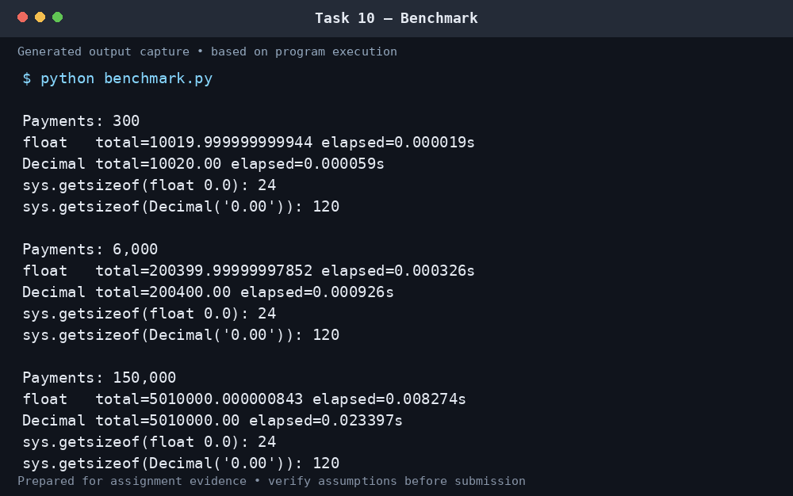

## Task 11 — Recommendation

Use Decimal values built from input strings for rates and payments, named constants for the rate card, explicit validation, reusable functions, a shared module and automated regression tests. Keep the original readings and delivery records if audits or corrections may be required. Make each seasonal rate revision in one rate configuration and test it against known examples. A production deployment would additionally need authenticated access, durable storage, backups, audit logs and protection against simultaneous conflicting updates. The included script is a teaching implementation rather than a database-backed co-operative system.

## Task 12 — Seasonal design

The design is modified rather than replaced: calculations remain modular, and the rate card is supplied as parameters. For April–June, the demonstration uses a base rate of ₹32.00 and a fat step value of ₹0.45; it keeps the SNF step value at ₹0.30 as an assumption. For July–March, the original ₹30.00 base rate and ₹0.40 fat step value are used because no alternative was supplied. The nearest 0.1 percentage-point step is used even when the analyser readings have two decimal places.

The bonus is ₹0.50 per litre when the ten-day supply is strictly greater than 500 L. Exactly 500 L receives no bonus; 501 L and 600 L qualify. In this demonstration the bonus is added to the current payment quantity, so the co-operative must confirm whether it is meant to apply to every litre in the ten-day period and how payments should be finalised before the ten-day total is known.

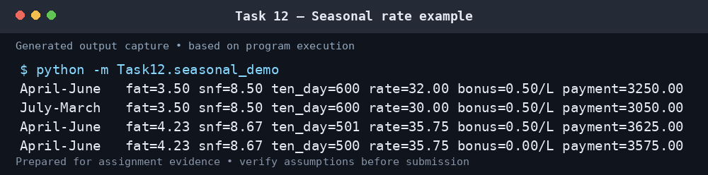

## Conclusion

The example implementation uses a central rate card, Decimal arithmetic, input validation, reusable functions, module imports and automated tests. Its calculations pass the included unit tests and its runtime grows linearly with the number of records. Before operational use, the SNF limits, step rounding, seasonal rules and bonus application should be approved by the co-operative. GitHub setup remains a submission step: create `CSA08-1921260129-Assignment1`, upload this project, make the required progressive commits, and insert the resulting repository URL on the cover page.

## References

1. Python Software Foundation. “`decimal` — Decimal fixed-point and floating-point arithmetic.” https://docs.python.org/3/library/decimal.html (accessed 21 October 2026). The documentation explains that Decimal can represent base-ten values exactly when used appropriately.
2. Python Software Foundation. “IDLE — Python editor and shell.” https://docs.python.org/3/library/idle.html (accessed 21 October 2026). The documentation explains how a program's printed output appears in the IDLE Shell.
3. Turnitin. “Understanding the similarity score for students.” https://guides.turnitin.com/hc/en-us/articles/23713493434253-Understanding-the-similarity-score (accessed 21 October 2026). Turnitin explains that the percentage is a similarity measure and that there is no universal acceptable percentage; the institution/instructor sets the relevant expectations.

## Remaining submission checks

- [ ] Confirm the accepted SNF range, rounding/bonus rules and the current deadline with the instructor or co-operative.
- [ ] Create `CSA08-1921260129-Assignment1` on GitHub, make progressive task commits and add the real repository URL to the cover page.
- [ ] Confirm whether local-PC screenshots are mandatory; replace these generated captures if required. Review the code and follow the institution's rules on AI assistance and disclosure.
