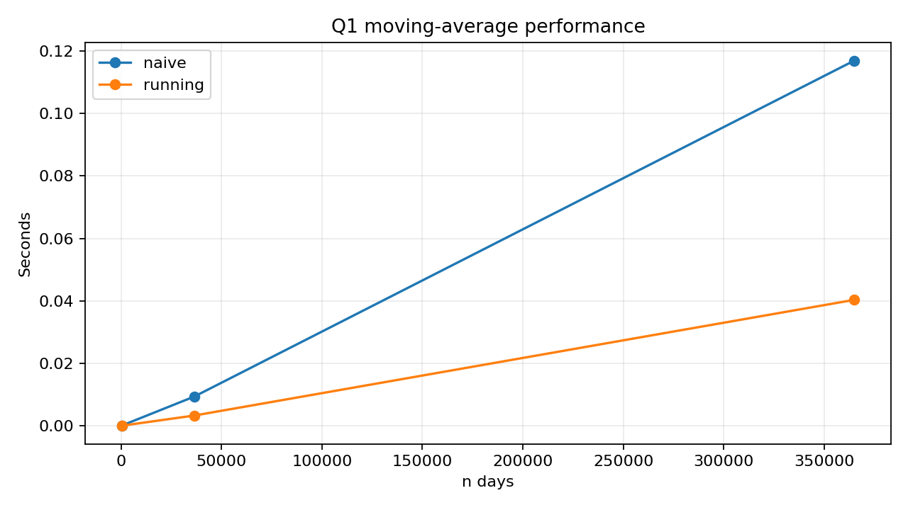
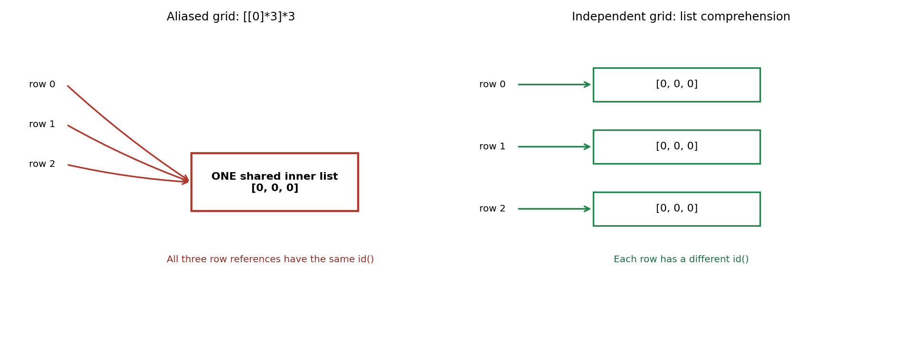
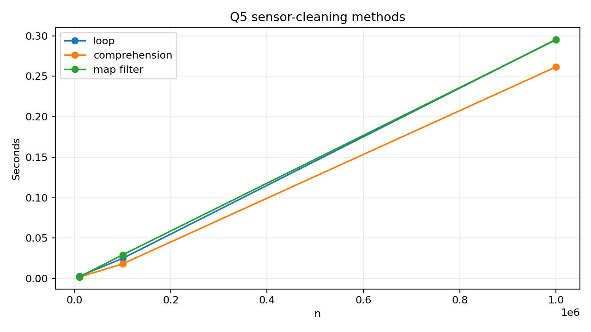
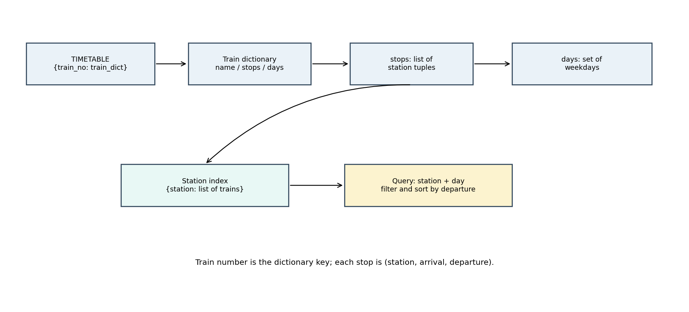
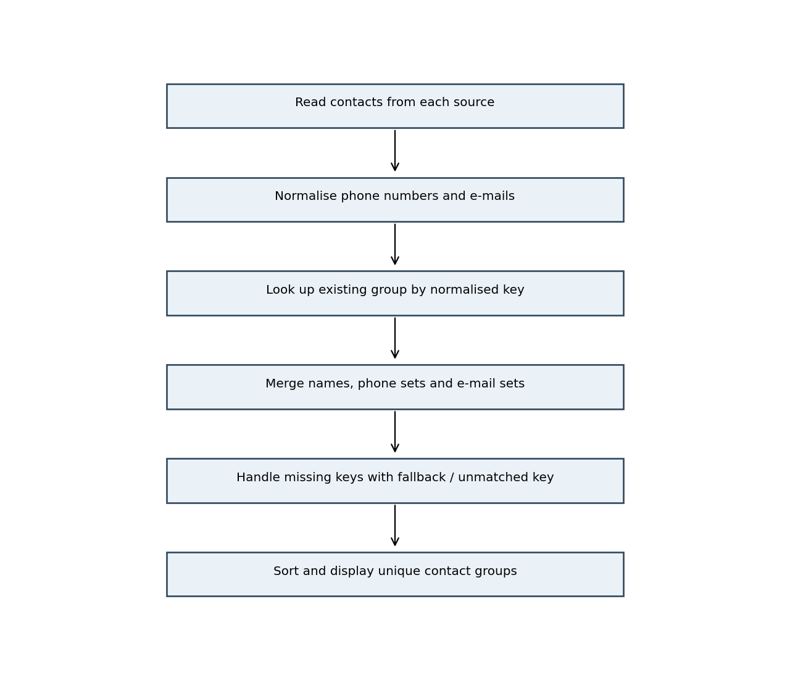
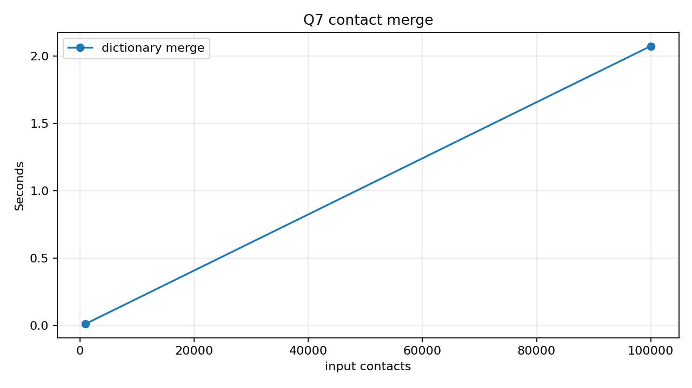

# Python Programming - Assignment 3 (CO3)

**Title:** Implement Python data structures to store, access and manipulate unstructured data  
**Student:** J. Hutson Kanth  
**Register number:** 1921260129  
**Course:** Python Programming  
**Repository:** `https://github.com/YOUR-USERNAME/CSA08-1921260129-Assignment3` *(replace with the real URL)*  
**Python runtime used for included measurements:** Python 3.13.5  
**Assignment submission date in brief:** 03 November 2026

---

## Objective and method

This assignment applies lists, tuples, dictionaries, sets and comprehensions to seven data-handling problems. Each question follows the sequence design, implementation, analysis and evaluation. Programs use reproducible synthetic or sample inputs; benchmark scripts write raw observations to CSV files. The displayed timings are from this Python 3.13.5 execution environment, not from the student's PC. Re-run them locally when the instructor requires device-specific measurements.

## Q1 - Lists and slicing: daily rainfall records (6 marks)

A list stores one rainfall reading per day. `weekly_totals` uses `readings[i:i+7]`; the final week is a partial group when the number of days is not divisible by seven. The maximum and minimum are compared across complete seven-day weeks and displayed as one-based week numbers; any trailing partial group is reported separately so it is not compared unfairly with a full week. Dry days are readings equal to zero.

**Moving-average pseudocode**

```text
if number of readings < 7: return empty list
sum the first 7 readings
append sum / 7
for each later day i:
    add readings[i]
    subtract readings[i - 7]
    append updated sum / 7
```

`readings[7:14]` returns values at indexes 7 through 13; `readings[-7:]` returns the final seven values; `readings[::7]` selects every seventh value beginning at index zero. A list supports indexing, slicing and appending. Typical costs: append amortised O(1), insert/pop near the front O(n), pop from the end O(1), and sort O(n log n).

For n readings and a window width of 7, the naive method performs `7(n-6)` additions when n ≥ 7. The running-sum version performs 7 initial additions, then n−7 additions and n−7 subtractions, giving O(n) time rather than O(7n) with a fixed-width window. Both return n−6 averages. Empty and shorter-than-seven inputs return an empty average list.

**Measured benchmark** (best of three runs; time depends on machine):

| days | windows | naive adds | rolling adds | rolling subtracts | naive s | running s |
| --- | --- | --- | --- | --- | --- | --- |
| 365 | 359 | 2513 | 365 | 358 | 0.000067 | 0.000023 |
| 36500 | 36494 | 255458 | 36500 | 36493 | 0.009367 | 0.003282 |
| 365000 | 364994 | 2554958 | 365000 | 364993 | 0.116968 | 0.040334 |


**Alternative: streaming deque.** Keep the most recent seven readings in `collections.deque(maxlen=7)`. Before appending to a full deque, subtract its oldest value from a running total; then append the new value, add it to the total and emit the average once seven values are present. This is O(n) time for n readings and O(7) window space. A dictionary keyed by date gives average O(1) direct date lookup and supports late records, but needs sorting by date (O(n log n)) before a chronological moving average. Its storage is O(n). An interior `list.insert()` costs O(n) because later entries shift; for a fixed one-year record, a list remains simple and suitable.

```python
from collections import deque
window = deque(maxlen=7)
total = 0.0
for value in readings:
    if len(window) == 7:
        total -= window[0]
    window.append(value)
    total += value
    if len(window) == 7:
        averages.append(total / 7)
```



## Q2 - Tuples, mutability and copying (7 marks)

A stop coordinate is represented as a tuple such as `(13.0827, 80.2707)` and used as a dictionary key. A tuple containing hashable immutable values can be hashed; a list is mutable and unhashable, so using a list as a dictionary key raises `TypeError`.

`[[0] * cols] * rows` repeats references to one inner list; changing one row changes all rows. The correct expression is `[[0 for _ in range(cols)] for _ in range(rows)]`, which creates independent rows. `is` and `id()` demonstrate object identity. An alias points to the same object; shallow copy duplicates only the outer container; deep copy recursively copies nested objects. A function that assigns through a list parameter mutates the same list object held by the caller. A tuple cannot have its slots reassigned, but it can contain a mutable list whose contents can still change.



**Measured container sizes and timings** (for one million references):

| values | list bytes | tuple bytes | list creation s | tuple creation s | list index s | tuple index s |
| --- | --- | --- | --- | --- | --- | --- |
| 1,000,000 | 8,000,056 | 8,000,040 | 0.045160 | 0.036213 | 0.001440 | 0.001390 |


`sys.getsizeof` above measures the shallow container only; it does not recursively include the integer objects referenced by the list or tuple. Indexing is O(1) for both. A tuple is appropriate for a fixed coordinate pair or record whose positions should not be reassigned; a list is appropriate when the collection must grow or change.

**Alternative: sparse dictionary.** Store only occupied zones using `(row, col)` as a key: `passengers[(r, c)] = passengers.get((r, c), 0) + count`. Average access is O(1), as with list indexing, but the dictionary uses O(k) entries for k occupied zones rather than O(rows × columns) cells. It is useful when the grid is large and mostly empty; a dense list of lists is simpler when most zones are used.

## Q3 - Dictionaries: farmer helpline complaint analysis (7 marks)

Words are lowercased and punctuation is replaced with spaces before counting, so text such as `seeds,water` remains two words. `frequencies_get` uses `dict.get()` to increment counts; `frequencies_setdefault` demonstrates the requested alternative. `group_by` uses `setdefault()` to create a district or crop list before appending a complaint. `top()` sorts by descending count and then alphabetically, which explains why `price` precedes `received` when both have count 2.

**Complete-the-code result:**

```text
[('seeds', 3), ('price', 2), ('received', 2)]
```

Dictionary lookup is average O(1) because the key's hash is used to locate a table position; pathological collisions can make an operation slower. Counting with a dictionary or `Counter` is average O(n) over n words; calling `list.count()` for each of d distinct words takes O(n·d). Dictionaries preserve insertion order in Python 3.7 and later. `keys()`, `values()` and `items()` are dynamic view objects for keys, values and key/value pairs.

| complaints | distinct | dict s | Counter s | list.count s | dict=Counter | dict=list |
| --- | --- | --- | --- | --- | --- | --- |
| 1000 | 20 | 0.005067 | 0.001173 | 0.006659 | True | True |
| 10000 | 20 | 0.036214 | 0.016935 | 0.085559 | True | True |
| 100000 | 20 | 0.585254 | 0.218161 | 0.684327 | True | True |


The synthetic data uses a fixed vocabulary to keep the list-count comparison measurable; punctuation in real complaint text is converted to separators before counting, and actual complaint text has a different distribution. Dictionary and Counter counting use O(d) count storage for d distinct words and average O(n) time over n words; `list.count()` rescans the word list for each distinct word and takes O(n·d) time. The alternative implementations are:

```python
from collections import Counter
counts_counter = Counter(word for word in all_words)
counts_list = {word: all_words.count(word) for word in set(all_words)}
```

In the measurements, Counter was fastest at each tested size; the dictionary method remains appropriate when custom filtering or grouping is needed. For 100,000 complaints, deploy Counter or a dictionary because both avoid repeated whole-list scans.

## Q4 - Sets: elective registration clash detection (7 marks)

The AI and IoT registrations are represented as sets, so duplicate register numbers are removed automatically. `&` returns students in both electives, `^` returns students in exactly one, and `all_students - (ai | iot)` returns students in neither. The solution is repeated using `intersection`, `symmetric_difference`, `union` and `difference` methods, and the results are compared.

**Verified small-case result:**

```text
clash      : ['192311004', '192311009']
exactly one: ['192311001', '192311002', '192311007', '192311010']
neither    : ['192311003', '192311005', '192311006', '192311008']
```


Membership on a list is O(n); average set membership is O(1). Sets are unordered and discard duplicate occurrences, so converting a list to a set loses both duplicate counts and positional order. A tuple of hashable values can be a set element; a list cannot. For n and m registrations, nested loops take O(n·m), sorting both lists and walking them takes O(n log n + m log m), and set operations are O(n + m) average.

| register numbers | list membership s | set membership s |
| --- | --- | --- |
| 10000 | 0.006118 | 0.000002 |
| 100000 | 0.054403 | 0.000003 |
| 1000000 | 0.601165 | 0.000002 |


The nested-loop comparison used sets of 800 and 900 elements; its measured time was 0.025610s versus 0.000095s for `&`. The sample results were identical.

## Q5 - List comprehension: cleaning sensor readings (6 marks)

The program removes sensor errors outside −50°C to 50°C and returns valid Celsius/Fahrenheit pairs. It implements the same transformation using a for-loop with `append`, a list comprehension, and `filter()` plus `map()` with lambda. `enumerate(..., start=1)` reports minute numbers where a valid temperature is outside 2–8°C. A dictionary comprehension and set comprehension are also shown. A generator expression produces values lazily; a list comprehension stores all values.

General form: `[expression for item in iterable if condition]`. A comprehension becomes less readable when it contains several nested loops or complicated conditions; a normal loop is clearer in that case. The three versions were checked for identical output; all-valid and all-invalid input cases were tested.

| readings | loop s | comprehension s | map/filter s | same result |
| --- | --- | --- | --- | --- |
| 10000 | 0.002786 | 0.001798 | 0.002012 | True |
| 100000 | 0.024962 | 0.018205 | 0.029334 | True |
| 1000000 | 0.295579 | 0.261635 | 0.295116 | True |


A list comprehension uses O(n) result memory; a generator expression uses O(1) additional iteration state (excluding the source iterable and any consumed results). `sys.getsizeof()` reports the shallow size of a generator object versus the materialised list; it does not report the full memory used by all nested objects. In this environment the comprehension was fastest at all three measured sizes, but timings vary with Python version, data and machine. The generator alternative is `valid_celsius = (c for c in readings if -50 <= c <= 50)`: it still examines n readings in O(n) time but uses O(1) additional iterator state rather than O(n) materialised result storage. It is useful when results can be processed one at a time; use a list when the complete result must be reused or indexed.



## Q6 - Nested data: railway timetable (7 marks)

The top-level dictionary maps train number to a train dictionary. Each train dictionary stores a name, a list of `(station, arrival, departure)` tuples, and a set of running days. This uses dictionaries for keyed train lookup, lists for ordered stops, tuples for fixed stop records, and sets for day membership.

The departure time of the third stop of train 12601 is `TIMETABLE['12601']['stops'][2][2]`. A direct query scans the train records and each train's stops. The station index maps a case-folded station name to a list of train references; then the query checks the running-day set and sorts by departure time using `sorted(..., key=lambda item: item[2])`.



| trains | scan s | indexed s | index bytes | same results |
| --- | --- | --- | --- | --- |
| 100 | 0.000030 | 0.000004 | 137,688 | True |
| 1000 | 0.000414 | 0.000048 | 1,338,480 | True |
| 10000 | 0.004725 | 0.001219 | 13,398,472 | True |


The index speeds repeated queries by restricting work to trains that visit the requested station, but it needs extra memory and must be updated whenever timetable stops or operating days change. A flat list of every stop can be scanned in O(total stops); a station index makes a query closer to O(trains at that station), after index construction. Index construction is O(total stops).

## Q7 - Contact merging from first principles (10 marks)

**Input:** contact records from two phones and a SIM, containing names, phone numbers and e-mails. **Output:** unique merged contact groups with all known names, canonical phone numbers and e-mail addresses.

**Measurable requirements:** (1) normalise every non-empty phone number to a digit-only canonical form; (2) merge records when at least one normalised phone number or e-mail matches; (3) preserve every non-empty name, phone and e-mail in the merged group without duplicates; (4) keep different phone identities separate even when names match; and (5) retain records with neither phone nor e-mail as separate unmatched contacts.

The program normalises phone numbers by retaining digits, removing the Indian `91` country prefix from 12-digit numbers and a leading zero from 11-digit numbers. E-mails are stripped and case-folded. A dictionary maps each normalised phone number to a contact group, while sets store names, numbers and e-mails without duplication. E-mail keys are used as a fallback if a record has no phone; records with neither phone nor e-mail remain separate unmatched entries.

**Pseudocode**

```text
create empty groups, number_index and email_index
for each contact from each source:
    normalise all phone numbers and e-mail addresses
    find existing groups using any matching number or e-mail
    if one or more groups match:
        choose a group and merge any other matching groups into it
    else:
        create a group using the first phone, otherwise e-mail, otherwise unique fallback
    add original name and normalised name to name sets
    add normalised phone numbers and e-mails to their sets
    update number and e-mail indexes
return groups in a stable display order
```



A dictionary-based merge is average O(n·p) for n input records with p phone numbers per record, assuming average O(1) dictionary lookups and set insertions. Comparing every pair is O(n²) time. Different people with the same name remain separate when their normalised phone numbers differ. A remaining limitation is that two records for one person with no shared phone or e-mail cannot be confidently linked automatically; automatic name-only merging could incorrectly combine different people.

| input contacts | dictionary merge s | merged groups |
| --- | --- | --- |
| 1000 | 0.013958 | 500 |
| 100000 | 2.074669 | 50000 |


The pairwise alternative was measured for 1,000 contacts: 0.020464s. At 100,000 contacts, the table records a quadratic extrapolation of 204.84s, clearly labelled as an estimate rather than an executed measurement. The dictionary algorithm was actually run for both 1,000 and 100,000 contacts.



## Automated checks

The included `tests/test_assignment3.py` contains 16 tests covering the main outputs and edge cases. The test run passed in this environment. Test output is in `evidence/all_tests.txt` and `evidence/all_tests.png`.

## Conclusion

Lists are effective for ordered records and slicing; tuples protect fixed coordinate/record structures; dictionaries support keyed counting and grouping; sets support uniqueness and set algebra; comprehensions provide concise data transformations; and nested structures plus indexes support repeated timetable/contact queries. Experimental results confirm that the choice of structure affects time and memory, while the appropriate design depends on update frequency, ordering, sparsity and correctness requirements.

## References

1. Python Software Foundation, *Built-in Types - list, tuple, set and dict*, Python 3.13 documentation: https://docs.python.org/3.13/library/stdtypes.html
2. Python Software Foundation, *Data Model - object identity, mutability and mappings*, Python 3.13 documentation: https://docs.python.org/3.13/reference/datamodel.html
3. Python Software Foundation, *collections - deque and Counter*, Python 3.13 documentation: https://docs.python.org/3.13/library/collections.html
4. Python Software Foundation, *copy - shallow and deep copy operations*: https://docs.python.org/3.13/library/copy.html
5. Python Software Foundation, *time - performance counter*: https://docs.python.org/3.13/library/time.html
6. Python Software Foundation, *sys - getsizeof*: https://docs.python.org/3.13/library/sys.html#sys.getsizeof

**Submission reminder:** replace the GitHub URL placeholder with the actual repository URL and confirm that the faculty can access it. This report is a draft based on the assignment brief; the student should review the code, understand all results, and disclose any AI assistance according to institutional rules.
